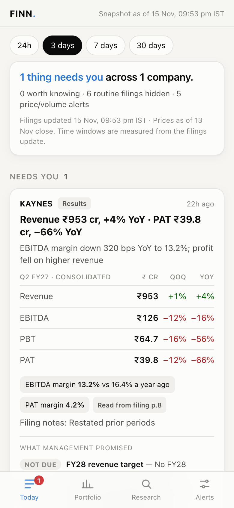
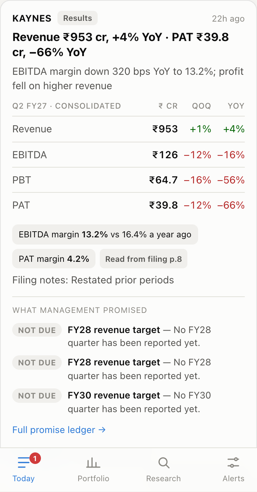
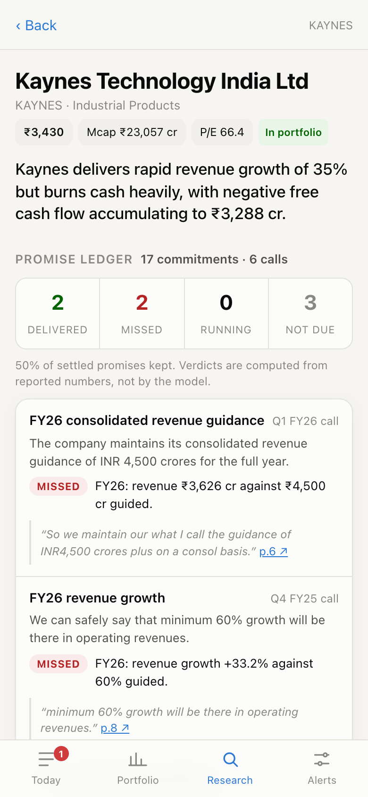
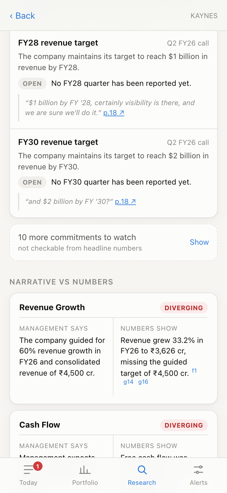

# FINN — a portfolio agent that filters, not aggregates

FINN is a mobile-first investment agent for Indian equities, built for the ENAM AI Engineer
build challenge. It does two jobs:

- **Push — "what changed, and should I care?"** Every exchange filing across an 18-stock
  portfolio is triaged into *needs you / worth knowing / hidden*. Results filings become a
  verified Revenue · EBITDA · PBT · PAT card (QoQ and YoY); management changes come with the
  appointee's background; unusual price or volume moves fire at thresholds you set.
- **Pull — "is management doing what it said?"** For any NSE company, FINN reads the last six
  earnings-call transcripts and the latest annual report, extracts every concrete commitment
  with a verbatim quote and page number, and **scores each promise against the numbers the
  company later reported**. Then it sets management's narrative against the numbers.

> The point of view: an investor doesn't need more information, they need *less, better
> sorted, and checkable*. So FINN is an inbox you can clear, not a feed you scroll — and its
> claims are traceable: every quote links to the transcript page it came from, every card to
> the filing, and every computed figure to the facts it was built from.

---

## Try it

| | |
|---|---|
| **App** | **https://animeshdubey6472.github.io/finn/** — open on a phone |
| **Run locally** | `python -m venv .venv && .venv/bin/pip install -r requirements.txt` → `cp .env.example .env` and add a free Gemini key → `.venv/bin/python -m finn serve` → http://127.0.0.1:8000 |
| **Research any ticker** | `python -m finn research COALINDIA` (or type it into the app's search when the local server runs) |
| **Refresh everything** | `python -m finn refresh` |
| **Alerts in the terminal** | `python -m finn alerts --move 3 --volume 2.5` |

Without an API key everything deterministic still works: prices, alerts, triage by rules,
fundamentals, and results cards from standardized data.

---

## 60-second tour

| Today — an inbox you can clear | A results card, checked | The promise ledger | Narrative vs numbers |
|---|---|---|---|
|  |  |  |  |

Three things to try on the [live app](https://animeshdubey6472.github.io/finn/) (on a phone):

1. **Today → 3 days.** One filing needs you: Kaynes' Q2 results, read from the filing — revenue
   ₹953 cr (+4% YoY), PAT ₹39.8 cr (−66%), EBITDA margin down 320 bps — with what management
   promised underneath. The routine paperwork is collapsed into a count.
2. **Research → KAYNES.** The promise ledger: FY26 revenue guided at ₹4,500 cr, delivered ₹3,626 cr
   (missed); margin expansion promised 50 bps, delivered 84 bps. Each quote links to its transcript
   page. Then compare HAL, where a margin promise is shown with both EBITDA definitions instead of
   a verdict.
3. **Alerts.** Drag the price-move slider and watch how many alerts a month you would get.

## What's on screen

**Today** — a one-line briefing ("3 things need you across 2 companies"), then:
- *Needs you*: material filings, each read and summarised. Results show the four headline
  numbers with a reconciliation badge; management changes show who the person is.
- *Unusual moves*: price/volume breaches at **your** thresholds, with the Nifty's move that day
  (is it the stock or the market?) and any filing made around the same time.
- *Worth knowing*: a compact list, one line each, tap to expand.
- *Hidden*: routine paperwork (ESOP allotments, newspaper ads, investor-meet intimations)
  collapsed into a count. It is still one tap away — hidden, not deleted.
- Window chips (24h default, 3/7/30 days). Seen items dim; the goal state is *caught up*.

**Company** — research ordered by what an analyst would want first:
1. **Promise ledger** — delivered / missed / behind / not yet due, each with the quote and a
   link to the transcript page. Verdicts are computed in code from reported financials.
2. **Narrative vs numbers** — "management says" beside "numbers show", tagged aligned /
   stretched / diverging.
3. **Bull vs bear**, three points each; each point cites the computed facts it relies on.
4. **Fundamentals** — snapshot, trend, balance sheet, cash quality (lenders get bank-appropriate
   measures instead of operating margin and cash conversion).
5. **From the annual report** — auditor's opinion, contingent liabilities, related parties.
6. **Sources & checks** — how many quotes were found verbatim, how many synthesized statements
   passed the figure check, which documents were read.

**Alerts** — threshold sliders with a live preview ("at these settings: 6 alerts in the last
month"), the filing types allowed to interrupt you, and what the run cost.

---

## Architecture

```
            ┌────────────── sources ──────────────┐
            │ screener.in   NSE RSS   Yahoo EOD    │   polite fetcher: honest UA, per-host pacing,
            │ (financials,  (live     (price,      │   disk cache (filings cached forever)
            │  filing links) filings)  volume)     │
            └──────┬──────────────┬────────┬───────┘
                   │              │        │
     PUSH          ▼              ▼        ▼                    PULL (any NSE symbol)
  ┌───────────────────────────┐  ┌─────────────┐      ┌──────────────────────────────────┐
  │ triage by rules (free)    │  │ signals     │      │ fundamentals → facts f1..fn (code)│
  │  └ borderline → read PDF  │  │ move%, vol× │      │ transcripts → guidance, claims    │
  │     results → numbers     │  │ vs Nifty    │      │   (cheap model, quoted + paged)   │
  │     people  → profile     │  └─────────────┘      │ quote check (code)                │
  │     other   → materiality │                       │ promise ledger (code)             │
  │ cluster duplicates        │                       │ annual report → notes (cheap)     │
  │ feed = memory across runs │                       │ synthesis (stronger model, 1 call)│
  └────────────┬──────────────┘                       │ figure check (code)               │
               │                                      └────────────────┬─────────────────┘
               └──────────────► web/data/*.json ◄──────────────────────┘
                                      │
                         static mobile web app (no build step)
                         + optional local server for live research
```

**The rule throughout: models read, code decides.** A model transcribes numbers from a
results filing; Python computes EBITDA, margins, QoQ and YoY, checks that PBT − tax = PAT, and
reconciles against standardized data. A model extracts guidance; Python decides whether it was
delivered. A model writes the synthesis; Python deletes any sentence containing a figure that
isn't in the fact pack it was given.

### Model routing and cost

| Tier | Default model | Used for | Calls per company |
|---|---|---|---|
| — | none (rules) | triaging filings — most of the feed | 0 |
| fast | `gemini-3.1-flash-lite` | reading a filing, a transcript, an annual report | ~1 per document |
| smart | `gemini-3.6-flash` | the one synthesis per company | 1 |
| search | off by default | appointee background from the web, only if the filing has none — opt-in, because Google search grounding is not in the free tier | 0 |

Each tier is an ordered fallback list; a free-tier cap or a hung model falls through to the
next. Model calls are cached by content, so a refresh only pays for what is new. Every call is
logged with tokens and list-price cost (`web/data/meta.json`, and the Alerts tab).

---

## Key decisions and trade-offs

- **Rules before models for triage.** Exchange subject lines are formulaic; ~50 ordered rules
  sort most filings for free and flag only the ambiguous middle for a model. Cost: rules need
  maintenance and will mis-sort novel phrasing — mitigated by a "no rule matched → read it"
  default and by letting the model move items across tiers (with guard rails: a results filing
  can't be demoted, paperwork can't be promoted).
- **Score only what is checkable, like for like.** The ledger scores company-level revenue,
  EBITDA and PAT targets (as growth, margin or rupees), annual capex, gross-debt ceilings and, for
  banks, deposit growth. Each commitment is extracted with its scope (company or segment) and,
  for margins, its basis (EBITDA, EBIT, PAT); only like-for-like promises get a verdict.
  Order books, capacity, segment targets, ratios and "we'll outgrow the market" stay as *watch
  items*, each with its next checkpoint. A wrong verdict would be worse than none.
- **Fundamentals from standardized data, narrative from primary documents.** Multi-year
  financials come from screener's standardized tables (consistent across companies, cheap);
  guidance and claims come only from transcripts and annual reports. No news, broker notes or
  model knowledge is used on the pull side.
- **Static app + JSON snapshot.** The app is three files with no build step, deployable
  anywhere and fast on a phone. Live research for an arbitrary ticker needs the small server.
- **Feed as memory.** Sources only list recent filings; the published feed is re-loaded each
  run, so history accumulates and nothing is read twice.
- **A failed refresh never replaces good data.** If prices fail, the last good prices stay; if a
  company fails to load, its history and last good row stay (marked stale); if nothing loads, the
  published feed is left untouched; research is only replaced by research at least as complete.
  Each refresh records per-source status, which the app shows as last-updated times and ⚠ warnings.

## Deliberately left out

- Intraday data and real-time push notifications (the brief is end-of-day; in-app alerts suffice).
- Chat as the main interface. Q&A exists in the engine but the product bet is that a ranked,
  clearable inbox plus a promise ledger beats a blank chat box for a daily workflow.
- Buy/sell calls, price targets, valuation models.
- LinkedIn scraping. SEBI requires every disclosure of a change in directors, KMP or senior
  management to include a "brief profile (in case of appointment)" (item 7.3 of
  [SEBI circular SEBI/HO/CFD/CFD-PoD-1/P/CIR/2023/123, 13 July 2023](https://www.sebi.gov.in/legal/circulars/jul-2023/disclosure-of-material-events-information-by-listed-entities-under-regulations-30-and-30a-of-securities-and-exchange-board-of-india-listing-obligations-and-disclosure-requirements-regulations-201-_73910.html)),
  so FINN reads the profile from the filing. A web lookup exists for filings without one, but is off by default: search grounding needs a paid Gemini key (set `FINN_MODELS_SEARCH`).

## Accuracy check

A labelled sample (30 filings stratified across tiers, plus every ledger verdict that is scored
or not yet due), scored by [`docs/accuracy/score.py`](docs/accuracy/score.py):

| Metric | Result |
|---|---|
| "Needs you" precision — filings FINN put in *needs you* that were labelled important | 9/10 (90%) |
| Recall — important filings FINN surfaced (*needs you* or *worth knowing*, not hidden) | 10/10 (100%) |
| Ledger accuracy — verdicts confirmed against the transcript quote and reported figures | 14/16 (88%) |

**Read this with care.** The sample is small, and the labels are a **self-assessment by the build
agent**, not an independent human review. Every verdict was re-checked against its quote and the
reported numbers, and the exercise caught a real bug (promises about years older than the
quarterly window were wrongly left "not yet due"; fixed before scoring). The four disagreements —
one over-promoted filing, one under-promoted, two questionable verdicts — are listed in
[`docs/accuracy/RESULTS.md`](docs/accuracy/RESULTS.md). Re-label `labels.csv` yourself and re-run
the script to get your own numbers.

## Known limitations (measured, not guessed)

- **The ledger scores only what headline financials can check.** Across the 22 researched
  companies, 25 of 323 extracted commitments (8%) get a verdict; the rest (order books, capacity,
  segment targets, store counts, "outgrow the market") are shown as watch items with their next
  checkpoint. Many companies (Reliance, TCS, Titan, IndiGo, all the lenders) guide almost entirely on
  such items, so their ledgers show watch lists rather than verdicts. For lenders, loan-book (AUM)
  guidance is never scored against income. Widening the checkable metrics (debt, rupee
  EBITDA/PAT, bank deposits) made verdicts more correct but did not raise coverage for this set.
- **EBITDA definitions differ.** Some companies count other income inside EBITDA. When a margin
  promise is met only under one definition, FINN shows both numbers instead of a verdict.
- **Revenue definitions differ.** Some companies (ITC, for one) print revenue *including* excise
  duty in the filing, while standardized data reports it net. FINN's reconciliation flags the
  gap on the card ("differs from standardized data") rather than silently choosing one.
- **Segment mix is thin.** Annual-report extraction finds segment names but rarely their revenue
  share, so the business snapshot leans on management's own description.
- **Insurers** are analysed with the same lens as industrial companies; operating margin and cash
  conversion are not meaningful for them.
- **Narrative analysis is pending for 15 companies.** All 22 have fundamentals, transcripts and the
  promise ledger; the narrative-vs-numbers and bull/bear sections exist for 7 so far, because the
  stronger model's free daily quota ran out. They are generated with
  `python -m finn research <SYMBOLS>` once it resets; each page says which model wrote its analysis.
- **Daily, not real-time.** A scheduled GitHub Action refreshes filings and end-of-day prices every
  weekday at 19:00 IST. It never commits; it starts from the published snapshot and deploys only if
  validation passes (most companies loaded, no published filings lost, prices not older), so a run
  blocked by a source leaves the last good site in place. Without a `GEMINI_API_KEY` repository
  secret, new filings are triaged by rules only; research is refreshed manually
  (`python -m finn research …`). Live research on a new ticker needs `python -m finn serve`.
- **Appointee backgrounds come from the filing.** SEBI requires a profile in the *appointment*
  disclosure, but a later filing (a shareholder vote, say) may not repeat it, and FINN sees only
  each company's most recent filings. For a CEO, CFO or Chair with no profile, FINN asks the model
  what it knows, accepts only a high-confidence, specific answer, and labels it *AI-generated ·
  unverified* with a verify link. For HDFC Bank's new CEO the model declined, so the card says why there is no profile
  and offers a one-tap search instead of guessing. Web-grounded lookup needs a paid Gemini key
  (`FINN_MODELS_SEARCH`).

## Where I'd take it next

1. Web-push notifications for "needs you" items (the app is already installable and refreshes daily).
2. Segment-level ledger: map segment guidance to segment results from investor decks.
3. An evaluation set: 50 hand-labelled filings and 20 hand-scored guidance items to measure
   triage precision and ledger accuracy, run on every prompt change.
4. Peer view: the same promise ledger across a sector ("who guides conservatively?").

---

## How it was built

Built in one session with Claude Code as the coding agent. The readable summary — how work was
split, the decisions I made, and the mistakes review caught — is in
[`docs/BUILD_HISTORY.md`](docs/BUILD_HISTORY.md); the full transcript is next to it.

## Repository

```
finn/
  sources/   screener.py (financials + document links), nse_feed.py, prices.py, pdf.py
  push/      classify.py (rules), enrich.py (read filings), results.py (card maths),
             signals.py (price/volume), digest.py (feed build)
  pull/      fundamentals.py (facts), transcripts.py, ledger.py, annual_report.py,
             grounding.py (quote + figure checks), research.py (orchestration)
  llm.py     tiered routing, fallback, cache, cost ledger
  prompts.py every prompt, versioned (the version is part of the cache key)
  pipeline.py, server.py, __main__.py
web/         index.html, app.css, app.js, data/
tests/       62 offline tests: core logic, parsers (synthetic page), failure scenarios
```

## Research and references

What I looked at before building, and what I took from each:

| Project | What it does | Taken / avoided |
|---|---|---|
| [virattt/dexter](https://github.com/virattt/dexter) | Autonomous US financial-research agent (plan → act → validate) | Self-validation idea; avoided open-ended agent loops — fixed pipelines are cheaper and auditable |
| [AI4Finance FinRobot](https://github.com/AI4Finance-Foundation/FinRobot) | Multi-agent equity research; numbers computed by code, not the LLM | Adopted "model reasons, code calculates" |
| [StrataLens / finance-agent](https://github.com/kamathhrishi/finance-agent) | Q&A over SEC filings with line-level citations | Citation-to-source discipline |
| [Arthneeti methodology](https://arthneeti.com/methodology) | Indian concall scorecard: guidance vs next quarter | Closest prior art I found; FINN scores against *reported financials* with explicit tolerances and shows its arithmetic |
| [BseIndiaApi](https://github.com/BennyThadikaran/BseIndiaApi) | Unofficial BSE wrapper | Confirmed BSE throttling behaviour; used official NSE RSS instead |
| [Lightyear AI updates](https://lightyear.com/en-gb/blog/ai-powered-market-intelligence-for-every-investor) | Retail app: summaries when a holding "moves significantly" | FINN makes the threshold the user's and shows market context |
| [FinanceBench (arXiv:2311.11944)](https://arxiv.org/abs/2311.11944) | LLM+retrieval answered 81% of financial questions wrongly or refused | Why every figure is computed or checked in code |
| [ECTSum (arXiv:2210.12467)](https://arxiv.org/abs/2210.12467) | Earnings-call summarisation benchmark | Calls are long and unstructured → extract structured items, not summaries |
| [Google SRE book — alerting](https://sre.google/sre-book/monitoring-distributed-systems/) | "Every page should be actionable"; signal over noise | The design rule for "needs you" vs "worth knowing" |

## Not investment advice

FINN is a prototype for a hiring exercise. It may be wrong; sources are linked throughout so
you can check.
